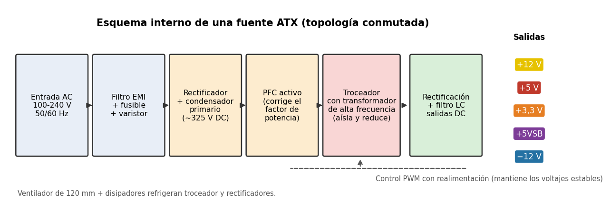
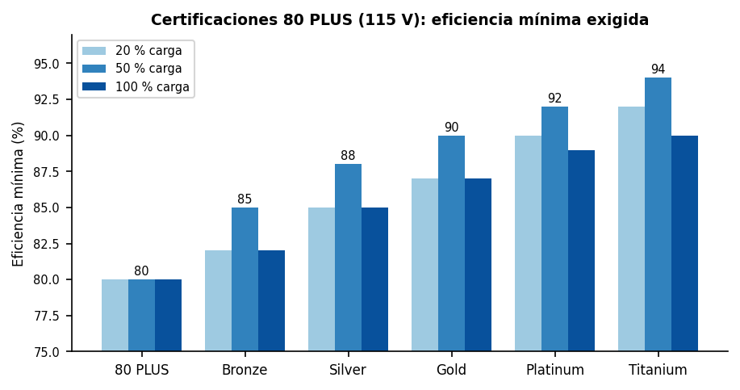
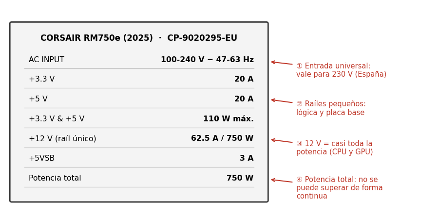

# Fuente de alimentación (PSU)

Componente: fuente de alimentación de un PC de sobremesa. Modelo que hemos analizado: Corsair RM750e (2025).

---

## 1. Qué es y para qué sirve

La fuente de alimentación (PSU, Power Supply Unit) es la parte del ordenador que coge la corriente alterna (AC) de la red y la convierte en corriente continua (DC) de voltajes bajos. En España la red es de 230 V AC y 50 Hz, pero la placa base, la CPU, la gráfica o los discos funcionan con +12 V, +5 V y +3,3 V en continua.

Lo que hace la fuente es esto:

- Rectificar: pasar de AC a DC.
- Transformar: bajar el voltaje y sacar varios voltajes distintos.
- Estabilizar: que cada voltaje se mantenga dentro de lo permitido (±5 % en +12 V, +5 V y +3,3 V según ATX) aunque cambie lo que consume el equipo.
- Proteger: cortar la salida si hay sobrecorriente, sobretensión, cortocircuito o si se calienta demasiado.

Todos los componentes dependen de ella. Si falla o es mala puede hacer que el PC se reinicie o se cuelgue, y hasta puede estropear la placa, la gráfica o los discos.

---

## 2. Cómo funciona por dentro

Las fuentes de los PC son fuentes conmutadas (SMPS). No usan un transformador grande de 50 Hz, sino que trabajan a una frecuencia alta (decenas de kHz). Así los componentes son más pequeños, pesan menos y se pierde menos energía.

Las etapas, de izquierda a derecha:

1. Filtro EMI: quita las interferencias de la red y evita que la fuente las devuelva. Lleva fusible y varistor, que protege de picos de tensión.
2. Rectificador y condensador primario: un puente de diodos pasa la AC a DC pulsante y un condensador grande la alisa (unos 325 V DC con 230 V de red).
3. PFC activo (Power Factor Correction): hace que la fuente coja la corriente en fase con la tensión, así mejora el factor de potencia.
4. Troceador y transformador de alta frecuencia: unos transistores cortan la DC miles de veces por segundo y el transformador baja el voltaje y aísla la salida de la red.
5. Rectificación y filtro de salida: se vuelve a rectificar y un filtro LC deja las salidas limpias (+12 V, +5 V, +3,3 V, −12 V y +5VSB).
6. Control PWM con realimentación: mide la salida y cambia el tiempo que conducen los transistores para que los voltajes no varíen.

El ventilador (de 120 mm en nuestro modelo) y los disipadores sacan el calor, que es la energía que se pierde al convertir.

---

## 3. Características, unidades y cómo se miden

| Característica | Unidad | Qué indica | Cómo se mide |
|---|---|---|---|
| Potencia | vatio (W) | Potencia total que da de forma continua | V·A; con una carga electrónica |
| Tensión de salida | voltio (V) | Voltaje de cada raíl (+12, +5, +3,3) | Polímetro o analizador de fuentes |
| Corriente máxima | amperio (A) | Intensidad que da cada raíl | Carga electrónica y amperímetro |
| Eficiencia | % | Potencia de salida / potencia de entrada | Vatímetro en la entrada y carga conocida en la salida |
| Rizado (ripple) | mV | Ondulación que queda en la DC | Osciloscopio |
| Ruido | dB(A) | Lo que suena el ventilador | Sonómetro a una distancia fija |
| Hold-up | ms | Tiempo que aguanta un microcorte de la red | Osciloscopio con un corte simulado |

Raíl único o múltiple: hoy casi toda la potencia va por el raíl de +12 V (CPU y GPU). Una fuente de raíl único da toda esa corriente por cualquier conector. Las de raíles múltiples la reparten y cada raíl tiene su propia protección.

Eficiencia y 80 PLUS: una fuente nunca convierte el 100 %, lo demás se pierde en calor. Por ejemplo, con un 90 % de eficiencia y 500 W de salida, la fuente consume unos 556 W de la red.

---

## 4. Tipos, evolución y estándares

Por tamaño: ATX (el estándar de sobremesa, 150 × 86 × 140 mm), SFX / SFX-L (cajas pequeñas), TFX (cajas finas) y Flex ATX (equipos compactos de marca).

Por cables:

- No modular: todos los cables van fijos. Es más barata pero queda más desordenado dentro de la caja.
- Semimodular: los cables principales son fijos y los demás se conectan.
- Totalmente modular: todos se conectan y solo pones los que necesitas.

Evolución de los estándares:

- AT (años 80–90): interruptor mecánico, no se apagaba por software.
- ATX (1995): apagado por software y señal de espera +5VSB.
- ATX12V (2000–2003): añade el conector de 4 pines para la CPU y el de 24 pines.
- ATX12V 2.x: el raíl de +12 V pasa a tener más peso, y aparecen los conectores PCIe y SATA.
- ATX 3.0 (2022): conector 12VHPWR para GPU de hasta 600 W y aguanta picos de consumo de hasta el doble de la potencia nominal.
- ATX 3.1 (2024): corrige ATX 3.0 y cambia el conector por el 12V-2x6, con contactos de sensado más cortos para evitar conexiones parciales.

Estándares de eficiencia: 80 PLUS (Estándar, Bronze, Silver, Gold, Platinum y Titanium) y también Cybenetics, que tiene niveles de eficiencia y de ruido.

---

## 5. Modelo comercial: Corsair RM750e (2025)

Referencia del fabricante: CP-9020295-EU (versión negra). Es una fuente totalmente modular de gama media-alta para equipos de juego actuales.

*La ficha la hemos hecho nosotros con los datos de tiendas y distribuidores, no es una foto de la etiqueta real.*

Qué significan los datos:

- 750 W y raíl +12 V único de 62,5 A: 62,5 A × 12 V = 750 W. Casi toda la potencia está en +12 V, que es lo que usan CPU y GPU.
- +3,3 V y +5 V con 20 A cada una: 66 W y 100 W, y entre las dos como máximo 110 W. Alimentan la lógica de la placa, los SSD y los USB.
- +5VSB de 3 A: mantiene la placa encendida en espera.
- Entrada de 100–240 V y 47–63 Hz: es universal, vale para cualquier país.
- 80 PLUS Gold / Cybenetics Gold: al menos 87 / 90 / 87 % de eficiencia al 20 / 50 / 100 % de carga con 115 V.
- ATX 3.1 y PCIe 5.1: trae el cable 12V-2x6 para las gráficas modernas.
- Ventilador de 120 mm con modo semipasivo (Zero RPM): con poca carga el ventilador se para y no hace ruido.
- Formato ATX, 140 mm de fondo y 7 años de garantía (según los distribuidores).

Valoración: 750 W sirve, por ejemplo, para una CPU de gama media-alta con una GPU de unos 300–350 W. Tiene buena relación calidad-precio, aunque algunos usuarios dicen que las RMe hacen un pequeño ruido (coil whine o clicking), cosa a tener en cuenta si el PC va a estar en un sitio silencioso.

---

## 6. Averías típicas y errores

Averías típicas:

- Condensadores hinchados o secos por el calor y el desgaste: dan rizado alto e inestabilidad.
- Ventilador bloqueado o con ruido: la fuente se calienta y se apaga.
- Fusible o varistor quemado: el equipo no da señal de vida después de una subida de tensión.
- Reinicios aleatorios o pantallazos azules con carga alta, por voltajes inestables.
- Se apaga al abrir un juego: salta la protección OCP/OPP por un pico de consumo.

Errores al elegirla:

- Mirar solo los vatios y no la calidad: una fuente barata de "750 W" puede no dar 750 W reales.
- Quedarse justo de potencia: es mejor dejar un margen del 20–30 % sobre el consumo máximo estimado.
- No fijarse en la certificación (80 PLUS / Cybenetics) ni en los condensadores.
- No comprobar los conectores que pide la GPU (8 pines o 12V-2x6).

Errores al instalarla:

- Usar cables de otra fuente modular: aunque encajen, los pines pueden estar distribuidos distinto y se pueden dañar los componentes.
- Conector 12V-2x6 mal metido o muy doblado cerca del conector: se calienta y se puede fundir.
- Olvidarse del conector EPS de la CPU (4+4 pines) o dejarlo flojo.
- Poner el ventilador mirando hacia una zona sin ventilación.
- Tocar el interior de la fuente: tiene condensadores que guardan carga peligrosa aunque esté desenchufada.

---

## 7. Fuentes y uso de IA

Fuentes:

1. Especificaciones de la Corsair RM750e (2025) de distribuidores: Scan.co.uk, Caseking.de, Multitronic.fi y Proshop (potencia, raíles, formato y garantía).
2. Descripción oficial de la serie RMe y de ATX 3.1 / PCIe 5.1 de Corsair.
3. Tablas de eficiencia de la certificación 80 PLUS (valores a 115 V).

Nota: algunas tiendas ponen 54,2 A en +12 V y otras 62,5 A (750 W). Hemos usado 62,5 A porque coincide con una fuente de 750 W de raíl único.

Uso de IA: hemos usado Claude (Anthropic) para ayudarnos a estructurar el documento y redactar los textos, y para hacer los esquemas (con Python y matplotlib). Los datos del modelo comercial los hemos contrastado con las fichas de los distribuidores, pero habría que revisarlos con la ficha oficial del fabricante antes de entregar.
