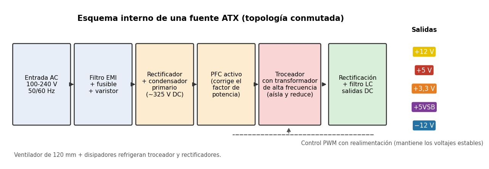
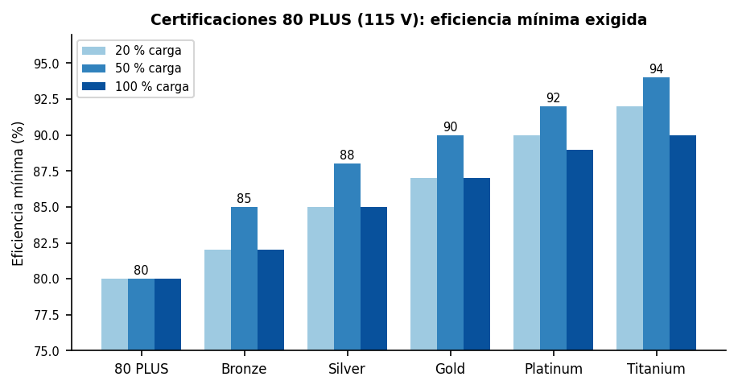
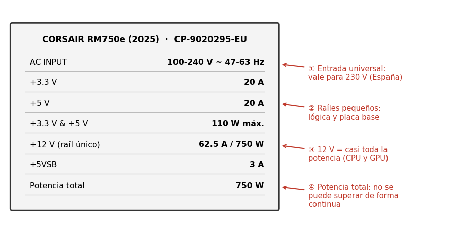

# Fuente de alimentación (PSU)

**Componente:** fuente de alimentación de un PC de sobremesa · **Modelo analizado:** Corsair RM750e (2025)

---

## 1. Qué es y qué función cumple en el sistema

La **fuente de alimentación** (*PSU, Power Supply Unit*) es el componente que **convierte la corriente alterna (AC) de la red eléctrica en las corrientes continuas (DC) de bajo voltaje** que necesitan todos los demás componentes del equipo. En España la red entrega 230 V AC a 50 Hz; la placa base, la CPU, la GPU o los discos trabajan con +12 V, +5 V y +3,3 V en continua.

Sus funciones son cuatro:

- **Rectificar:** pasar de AC a DC.
- **Transformar:** reducir el voltaje y generar varios niveles distintos.
- **Estabilizar:** mantener cada voltaje dentro de tolerancia (±5 % en +12 V, +5 V y +3,3 V según la norma ATX) aunque cambie la carga.
- **Proteger:** cortar la salida ante sobrecorriente, sobretensión, cortocircuito o sobrecalentamiento, para no dañar el resto del equipo.

Es el único componente del que dependen todos los demás: si falla o es de mala calidad, puede provocar reinicios, cuelgues e incluso daños en placa, GPU o discos.

---

## 2. Cómo funciona por dentro

Las fuentes de PC son **fuentes conmutadas** (SMPS). En lugar de usar un transformador grande a 50 Hz, trabajan a alta frecuencia (decenas de kHz), lo que permite componentes mucho más pequeños, ligeros y eficientes.

Etapas, de izquierda a derecha:

1. **Filtro EMI:** elimina interferencias de la red y evita que la fuente las devuelva. Incluye fusible y varistor (protege de picos).
2. **Rectificador + condensador primario:** un puente de diodos convierte la AC en DC pulsante y un condensador grande la alisa (unos 325 V DC con red de 230 V).
3. **PFC activo** (*Power Factor Correction*): hace que la fuente consuma la corriente "en fase" con la tensión, lo que mejora el factor de potencia y reduce la corriente desperdiciada.
4. **Troceador y transformador de alta frecuencia:** unos transistores conmutan la DC miles de veces por segundo; el transformador **reduce el voltaje y aísla** eléctricamente la salida de la red.
5. **Rectificación y filtro de salida:** se rectifica de nuevo y un filtro LC deja las salidas limpias (+12 V, +5 V, +3,3 V, −12 V y +5VSB).
6. **Control PWM con realimentación:** un circuito mide la salida y ajusta el tiempo de conducción de los transistores para mantener los voltajes estables.

El **ventilador** (120 mm en nuestro modelo) y los disipadores evacuan el calor, que es la energía que se pierde en la conversión.

---

## 3. Características, unidades y cómo se miden

| Característica | Unidad | Qué indica | Cómo se mide |
|---|---|---|---|
| **Potencia** | vatio (W) | Potencia total que puede entregar de forma continua | Producto V·A; se comprueba con una carga electrónica |
| **Tensión de salida** | voltio (V) | Nivel de cada raíl (+12, +5, +3,3) | Polímetro o analizador de fuentes |
| **Corriente máxima** | amperio (A) | Intensidad que puede dar cada raíl | Carga electrónica y amperímetro |
| **Eficiencia** | % | Potencia de salida / potencia de entrada | Vatímetro en la entrada y carga conocida en la salida |
| **Rizado (ripple)** | mV | Pequeña ondulación residual en la DC | Osciloscopio |
| **Ruido acústico** | dB(A) | Nivel sonoro del ventilador | Sonómetro a distancia fija |
| **Tiempo de hold-up** | ms | Tiempo que aguanta un microcorte de red | Osciloscopio en un corte simulado |

**Raíl único o múltiple:** hoy casi toda la potencia va por el raíl de +12 V (CPU y GPU). Una fuente de **raíl único** ofrece toda esa corriente a cualquier conector; las de **raíles múltiples** la reparten y limitan cada uno con una protección propia.

**Eficiencia y certificación 80 PLUS:** una fuente nunca convierte el 100 %; el resto se pierde en calor. Un 90 % de eficiencia con 500 W de salida significa que consume unos 556 W de la red.

---

## 4. Tipos, evolución y estándares actuales

**Por formato (tamaño):** **ATX** (el estándar de sobremesa, 150 × 86 × 140 mm), **SFX / SFX-L** (cajas pequeñas), **TFX** (cajas finas) y **Flex ATX** (equipos compactos de marca).

**Por cableado:**

- **No modular:** todos los cables van fijos. Es m√°s barata pero desordena la caja.
- **Semimodular:** los cables principales son fijos y el resto se conectan.
- **Totalmente modular:** todos los cables se conectan y se puede usar solo los necesarios.

**Evolución de los estándares:**

- **AT** (años 80–90): interruptor mecánico, sin apagado por software.
- **ATX (1995):** apagado por software y señal de espera +5VSB.
- **ATX12V (2000–2003):** añade el conector de 4 pines para la CPU y el de 24 pines.
- **ATX12V 2.x:** mayor peso del raíl de +12 V, conector PCIe y SATA.
- **ATX 3.0 (2022):** conector **12VHPWR** para GPU de hasta 600 W y tolerancia a picos de consumo (*excursions*) de hasta el doble de la potencia nominal.
- **ATX 3.1 (2024):** corrige y endurece ATX 3.0 y sustituye el conector por el **12V-2x6**, con contactos de sensado más cortos para evitar fallos de conexión parcial.

**Est√°ndares de eficiencia:** **80 PLUS** (Est√°ndar, Bronze, Silver, Gold, Platinum, Titanium) y, en paralelo, **Cybenetics** (con niveles de eficiencia y de ruido).

## 5. Un modelo comercial real: Corsair RM750e (2025) y su ficha técnica

Referencia del fabricante: **CP-9020295-EU** (versión negra). Es una fuente totalmente modular de gama media-alta, pensada para equipos de juego actuales.

*La ficha de arriba la hemos elaborado a partir de los datos publicados por tiendas y distribuidores; no es una foto de la etiqueta real.*

**Interpretación de los datos:**

- **750 W, raíl +12 V único de 62,5 A:** 62,5 A × 12 V = 750 W. Casi toda la potencia está disponible en +12 V, que es lo que consumen CPU y GPU.
- **+3,3 V y +5 V con 20 A cada una:** 66 W y 100 W; entre ambas, 110 W como máximo. Alimentan lógica de la placa, SSD y USB.
- **+5VSB de 3 A:** la tensión que mantiene encendida la placa en espera.
- **Entrada 100–240 V, 47–63 Hz:** entrada universal; funciona en cualquier país.
- **80 PLUS Gold / Cybenetics Gold:** al menos 87 / 90 / 87 % de eficiencia al 20 / 50 / 100 % de carga con 115 V.
- **ATX 3.1 y PCIe 5.1:** incluye el cable **12V-2x6** para tarjetas gr√°ficas modernas.
- **Ventilador de 120 mm con modo semipasivo (Zero RPM):** a poca carga el ventilador se detiene y la fuente es silenciosa.
- **Formato ATX, 140 mm de fondo y 7 años de garantía** (según los distribuidores consultados).

**Valoración:** una fuente de 750 W es adecuada, por ejemplo, para una CPU de gama media-alta con una GPU de unos 300–350 W. Es una buena relación calidad–precio, aunque algunos usuarios reportan un leve chasquido ("coil whine" o "clicking") en unidades RMe, algo a tener en cuenta si el equipo va a estar en un lugar silencioso.

---

## 6. Averías típicas y errores al elegirla o instalarla

Aver°as m†s habituales

El equipo no enciende: fusible fundido, condensador primario hinchado, fallo de la fuente auxiliar +5VSB o de la se§al PS_ON. Se puede comprobar con el test del clip (puenteando PS_ON, el cable verde, con un cable negro) para ver si el ventilador arranca; no confirma que las tensiones sean correctas.
Reinicios o apagados aleatorios: la protecci¢n OCP u OPP salta por sobrecarga, o hay un recalentamiento por polvo acumulado o ventilador bloqueado.
Pitidos o zumbido elÇctrico (coil whine): bobinas o transformadores vibrando; molesto pero no siempre peligroso.
Inestabilidad bajo carga: condensadores electrol°ticos envejecidos que pierden capacidad (la gran causa de fallo con los a§os), lo que aumenta el rizado.
Olor a quemado, humo o chispazos: apagar y desenchufar de inmediato; hay riesgo de incendio o de da§o a otros componentes.

Errores al elegirla

Fijarse solo en los vatios. Una fuente barata de 750 W puede ofrecer menos potencia real que una buena de 550 W.
Subdimensionarla y dejarla funcionando siempre cerca del 100 %: se calienta m†s y envejece antes.
Sobredimensionarla en exceso (por ejemplo, 1000 W para un equipo de 200 W): a carga muy baja la eficiencia cae.
Ignorar el est†ndar (ATX 3.x) y los conectores que necesita la gr†fica.
No comprobar la certificaci¢n ni revisar an†lisis independientes (ripple, protecciones, componentes).

Errores al instalarla

Usar adaptadores o cables de otro modelo. Aunque los conectores encajen, el pinout puede ser distinto y destruir componentes. Solo deben usarse los cables del propio fabricante y del propio modelo.
Conectar mal el 12VHPWR: si no entra del todo, aumenta la resistencia de contacto y puede fundirse el conector. Debe insertarse hasta el fondo y sin doblar el cable cerca del enchufe.
Ventilador mal orientado: debe aspirar aire fresco, no recalentado desde el interior de la caja.
Colocar regletas o cables que obstruyan la entrada de aire.
Abrir una fuente conectada o reciÇn desenchufada: los condensadores primarios pueden conservar tensi¢n peligrosa. En clase no se debe abrir nunca.

## 7. Fuentes y uso de IA

**Fuentes consultadas**

1. Especificaciones de la Corsair RM750e (2025) publicadas por distribuidores: Scan.co.uk, Caseking.de, Multitronic.fi y Proshop (datos de potencia, raíles, formato y garantía).
2. Descripción oficial de la serie RMe y de ATX 3.1 / PCIe 5.1 de Corsair, recogida en las fichas anteriores.
3. Tablas de eficiencia de la certificación 80 PLUS (valores a 115 V).

*Nota:* algunas tiendas indican 54,2 A en +12 V, mientras que otras indican 62,5 A (750 W); hemos usado 62,5 A, que coincide con el producto de 750 W en raíl único.

**Uso de IA**

Se ha usado **Claude (Anthropic)** para estructurar el documento, redactar los textos y generar los esquemas (creados con Python y matplotlib). Los datos técnicos del modelo comercial se han contrastado con las fichas de distribuidores citadas; conviene que el alumno los verifique con la ficha oficial del fabricante antes de entregar.
